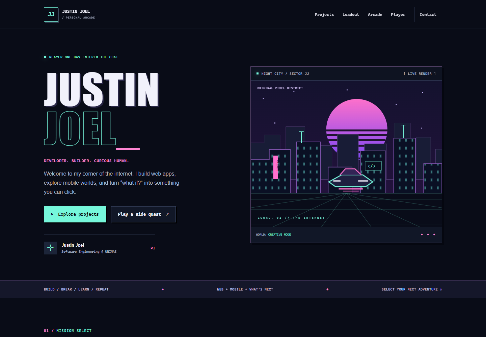

# Justin Joel · Personal Arcade

A static Astro site with a retro video-game / cyberpunk theme, an animated original SVG city, typed content, six project detail pages, and a playable side quest. Projects and play come first; experience and education are in expandable player-profile panels. Three resume-backed projects remain distinct from newer learning projects and concepts. No backend, trackers, external fonts, or frontend framework runtime.

## Interactive features

- Mission-select filters: built projects, explorations, or all six. Without JavaScript all projects remain visible.
- Project and interest cards tilt with a mouse and highlight on keyboard focus. Tool tiles lift and show an inspection readout when selected.
- Local SVG icons identify tools. Simple Icons supplies available brand marks; general code symbols cover non-brand practices/platforms and unavailable marks. Some ecosystem tools use their parent framework icon. Text labels always identify the actual tool. See [icon attribution](THIRD_PARTY_NOTICES.md).
- **Signal Run:** a small 8×6 packet-collection game. Start a run, then use arrow keys/WASD while the grid is focused, or the touch direction buttons. Collect five packets, view the move count, and restart. There is no timer, audio, network, or persistent score.
- Footer controls switch cyan/pink/amber accents and turn motion off. System reduced-motion preferences also disable animation and tilt. Display settings reset on page navigation.
- Native disclosures keep education, experience, strengths, and experimental tools readable with or without JavaScript.

Interaction code lives in `src/scripts/interface.ts`; the game is self-contained in `src/components/Arcade.astro`. Theme and responsive styles live in `src/styles/global.css`.

## Local setup

Use **Node 24.22.1** (`.nvmrc`) and npm. Verified with npm **11.3.0**, Astro **7.4.2**, TypeScript **6.0.3**, and Tailwind CSS / `@tailwindcss/vite` **4.3.3**. Exact dependency versions are recorded in `package.json` and `package-lock.json`.

From this repository in VS Code’s terminal:

```powershell
node --version
npm.cmd ci
npm.cmd run dev
```

Open the local URL printed by Astro. On macOS/Linux, use `npm` in place of `npm.cmd`. On Windows, `.cmd` avoids PowerShell execution-policy restrictions. Do not open an HTML file directly: Astro needs to build the pages and CSS.

The implementation session downloaded an ignored, project-local Node runtime under `.tools/` because the system Node 22.15.0 was too old. For an immediate preview on this checkout without changing system Node:

```powershell
$env:ASTRO_TELEMETRY_DISABLED = '1'
.\.tools\node_modules\node\bin\node.exe node_modules/astro/bin/astro.mjs dev
```

That runtime is not part of the repository. Other checkouts should install the Node version in `.nvmrc` normally.

## Edit content

| File | Content |
| --- | --- |
| `src/data/profile.ts` | Name, intro, biography, contact destinations, experience, education, spoken languages |
| `src/data/projects.ts` | Featured and exploratory projects, statuses, technologies, contributions, optional links and images |
| `src/data/skills.ts` | Used tools and a separate exploration list |
| `src/data/interests.ts` | Interests and working strengths |
| `src/styles/global.css` | Theme tokens, typography, responsive layouts, focus and motion styles |

Add one typed project entry to create its internal page automatically. The mission filters use `status: 'built'`, `'learning'`, or `'planned'`; `featured` controls detail-page presentation and the return link. Keep `featured: true` for demonstrated work and `false` for explorations. Use a unique lowercase slug. Retain `null` for unavailable links. Only supplied HTTPS repository/demo URLs render external actions. There is no placeholder resume link or contact form: email, LinkedIn, and GitHub are direct links.

Place permission-cleared project screenshots in `public/images/`, then set `image` to `{ src: 'images/example.png', alt: 'A descriptive caption', kind: 'screenshot' }`. Use a 16:9 image to match the supplied dimensions. The default SVG covers are clearly labeled illustrations.

See [CONTENT_TODO.md](CONTENT_TODO.md) for missing URLs, screenshots, optional public-safe resume, and date reviews. Resume facts are transcribed from the supplied brief; the original resume was not in the checkout. Do not expose private REKA/client material or promote explorations to completed work without evidence.

## Checks and screenshots

```powershell
npm.cmd run check
npm.cmd run build
npm.cmd run test:links
npm.cmd run preview
# In a second terminal, with local Google Chrome installed:
npm.cmd run test:browser
```

The browser check uses installed Chrome through Playwright, with axe WCAG A/AA checks. Set `BROWSER_CHANNEL=msedge` to use installed Edge instead. Set `TEST_URL` if the preview uses a different origin. It saves full-page and viewport screenshots in ignored `.qa/`. The reference previews below are actual local screenshots of this portfolio, not screenshots of featured applications.



[Mobile portfolio preview](docs/preview-mobile.png)

Verified locally on 25 October 2026:

- Clean `npm ci`, Astro type checking, and production build.
- Eight generated pages and 102 local links/assets, plus Open Graph image existence.
- Root and `/portfolio/` base modes, including production preview and all six project routes.
- Chrome at 320, 375, 768, and 1440px: no horizontal page overflow; no axe WCAG A/AA violations in the tested views.
- Mobile menu keyboard operation, Escape and focus return, skip link, no-JavaScript navigation, reduced-motion behavior, 200% CSS zoom, and 404 home link.
- No JavaScript errors or failed asset requests during those browser checks.
- Project filters, mouse tilt, tool selection/icons, expandable profile panels, all three neon palettes, motion toggle, and a full 28-move arcade completion plus reset/boundary checks.

Automated accessibility checks are not a complete manual assistive-technology audit. CSS zoom was tested, not the browser’s native zoom UI. Lighthouse scores, mail delivery, contact account ownership, and live GitHub Pages deployment have not been verified.

`public/images/social-preview.png` is a real 1200×630 social card generated from the original editable SVG. Regenerate with `node scripts/social-image.mjs` after editing the SVG. All other illustrations remain lightweight SVG/CSS.

## GitHub Pages (prepared, not published)

The configured intended destination is `https://justinj03.github.io/` for `JustinJ03.github.io`. The site uses static output and no base prefix by default. The workflow follows the [Astro GitHub Pages deployment guidance](https://docs.astro.build/en/guides/deploy/github/), with explicit install/check/build/upload steps so validation runs before deployment. Tailwind uses its [official Vite integration for Astro](https://tailwindcss.com/docs/installation/framework-guides/astro).

When you explicitly decide to publish:

1. In the repository’s Settings → Pages, choose **GitHub Actions** as the source.
2. Review and commit the source, lockfile, and `.github/workflows/deploy.yml`.
3. Push to `main`, or manually run the workflow on `main` after the workflow exists remotely.

The workflow performs a lockfile install, type checking, production builds, and local-link checks in both base modes. Pull requests only validate; the deployment job and Pages upload run only on `main` outside PR events. Deployment uses the `github-pages` environment, scoped `pages: write` / `id-token: write` permissions, and production concurrency. No credentials are embedded. No push or publication was performed during implementation.

For a future repository named `portfolio`, set `SITE_BASE=/portfolio` in the build environment and preview with the same value. The `site` origin stays unchanged. Paths, canonical URLs, images, and project links are base-aware. To test locally in PowerShell:

```powershell
$env:SITE_BASE = '/portfolio'
npm.cmd run build
npm.cmd run test:links
npm.cmd run preview
# In a second terminal, with the same SITE_BASE:
$env:SITE_BASE = '/portfolio'
npm.cmd run test:browser
```

Stop preview, remove the temporary base with `Remove-Item Env:SITE_BASE`, and rebuild to restore the root site. Before actually switching repository type, update the deployment workflow’s final build environment too; its current final build intentionally restores the user-site root.

## Troubleshooting

- Engine warnings: use Node 24.22.1 in both the terminal and CI. Node 22.15.0 is insufficient for this Astro release.
- PowerShell blocks `npm.ps1`: use `npm.cmd`; changing machine execution policy is unnecessary.
- Port already used / another preview exists: stop the existing process or run `npx.cmd astro preview stop` before starting a new preview.
- Missing styles or broken project links: use the printed preview URL with its base prefix and rebuild after changing `SITE_BASE`.
- Browser test cannot find Chrome: install Chrome normally or set `$env:BROWSER_CHANNEL = 'msedge'` if Edge is installed.
- Restricted environments may require network approval for `npm ci`. `ASTRO_TELEMETRY_DISABLED=1` avoids Astro’s user-profile telemetry configuration writes.
